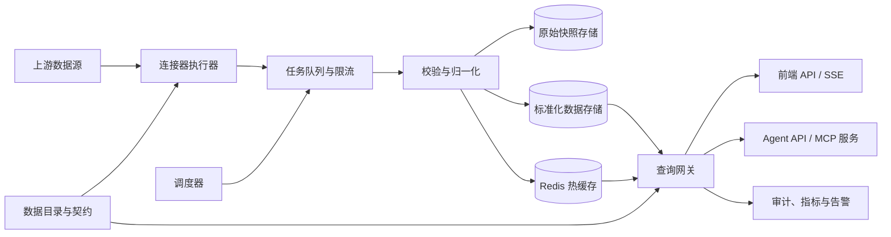

# 市场数据接口平台架构方案（V1）

## 1. 目标与边界

平台将已整理的市场数据接口转化为可治理、可复用的数据产品，面向两类消费者：

- 前端页面：读取最新快照、历史快照和有限的订阅更新。
- Agent（如 WorkBuddy）：按自然语言任务发现数据集、读取结构化结果、获得来源和新鲜度信息。

平台的职责是按已定义的连接器规则拉取上游、校验并标准化数据、缓存和保存版本、对外提供稳定 API。它不应成为任意 URL 的开放代理，也不应将上游认证令牌交给浏览器或 Agent。

上游接口的使用必须在其授权、服务条款、robots 规则及适用的数据许可范围内进行。上线前应完成数据来源授权和再分发权确认；未获授权时，平台仅应作为内部分析工具，禁止向第三方开放。

## 2. 已知输入与设计结论

现有分析材料确认：

- 主接口族为 `GET /market/pool/{id}`，约 273 个已探测接口；同时存在个股行情、题材和 WebSocket 等特殊接口。
- 多数接口能够直接返回，但存在列表、对象、空池、需要业务参数及“带任意参数触发”五类行为。
- 同一数据集的实时和历史响应可能有不同字段结构。例如涨停池实时数据为嵌套驼峰命名，按 `date` 查询的历史数据为扁平下划线命名。
- 上游使用短期匿名 JWT，并且 token 端点有限流；浏览器跨域直连不可作为生产接入方式。

因此，接口号只可作为连接器内部定位符。对外发布的数据集要以语义化 ID、版本和参数契约表达，例如 `market.limit_up.v1`，而非暴露 `pool/2`。

## 3. 总体架构



**连接器执行器**负责认证、请求构造、重试、熔断和上游限流；它不承载公开 HTTP 流量。**数据目录**定义可发布的数据集、输入参数、刷新策略、字段契约、保留期和访问策略。**查询网关**只读取缓存或存储结果，必要时触发受控刷新，永不把客户端参数原样转发到上游。

## 4. 核心域模型

| 对象 | 关键字段 | 作用 |
| --- | --- | --- |
| `connector` | `id`, `base_url`, `auth_profile`, `rate_limit`, `status` | 一个经过批准的上游连接方式 |
| `dataset` | `id`, `version`, `connector_id`, `source_route`, `schema`, `access_policy` | 对外稳定的数据产品 |
| `parameter_spec` | `name`, `type`, `required`, `enum/pattern`, `default` | 参数白名单和校验规则 |
| `refresh_policy` | `cron`, `market_session`, `ttl`, `stale_ttl`, `priority` | 调度和缓存规则 |
| `snapshot` | `dataset_id`, `parameter_hash`, `fetched_at`, `as_of`, `payload_uri`, `checksum`, `quality` | 一次原始抓取结果，可追溯 |
| `normalized_record` | `snapshot_id`, `entity_key`, `payload`, `schema_version` | 标准化后的记录 |
| `delivery_event` | `consumer`, `dataset_id`, `snapshot_id`, `trace_id` | Agent/API 调用审计与计量 |

每个响应均携带元数据：`dataset`、`version`、`as_of`、`fetched_at`、`expires_at`、`stale`、`source`、`snapshot_id`。这使前端可标识延迟，Agent 可引用数据版本而不是臆测“实时”。

## 5. 接口设计

### 前端查询 API

```http
GET /v1/datasets/market.limit_up/records?trade_date=2026-10-09&limit=50
Authorization: Bearer <platform-token>
```

返回统一信封：

```json
{
  "meta": {
    "dataset": "market.limit_up",
    "version": "v1",
    "snapshot_id": "snp_01J...",
    "as_of": "2026-10-09T15:01:00+08:00",
    "fetched_at": "2026-10-09T15:01:04+08:00",
    "stale": false
  },
  "data": [{"security_id":"CN.SSE.600026","name":"...","last_price":22.62,"change_pct":10.02}]
}
```

建议同时提供：`GET /v1/catalog/datasets`（可见数据目录）、`GET /v1/datasets/{id}/schema`（JSON Schema）、`GET /v1/datasets/{id}/snapshots`（历史版本）和 `GET /v1/stream/{id}`（SSE，仅发布快照更新事件）。前端实时展示应以短轮询/SSE 读取平台快照，不能直接轮询上游。

### Agent 接入

为 WorkBuddy 等 Agent 提供 MCP Server，工具保持小而确定：

- `search_datasets(query, domain, freshness)`：发现可用数据集及字段。
- `get_dataset(dataset_id, parameters, snapshot)`：读取受限页大小的标准化数据。
- `get_snapshot_metadata(snapshot_id)`：取得来源、新鲜度、质量和字段版本。
- `query_market_entities(dataset_id, filters, sort, limit)`：仅允许目录声明的过滤/排序字段。

MCP 工具调用身份映射到平台服务账号，按数据集授予最小权限并施加每工具配额。Agent 返回给用户时应保留数据时间和来源标签。

## 6. 归一化与版本策略

以“领域模型 + 原始快照”双轨保存：原始 JSON 用于审计与适配器回放，领域模型用于 API、检索和跨源计算。第一批领域模型包括：

- `Security`：统一证券标识、名称、市场、代码别名。
- `Quote`：价格、涨跌幅、成交额、时间。
- `StockPoolMembership`：证券、池类型、交易日、排名、池特有指标。
- `Sector` 和 `SectorConstituent`：行业/概念、成分及强度指标。
- `MarketBreadth`：涨跌停、涨跌家数、情绪等市场级指标。

以涨停池为例，将两种上游结构映射为 `StockPoolMembership`，统一 `security_id`、`last_price`、`change_pct`（百分数）、`consecutive_limit_up_days`、`break_limit_up_count`、`first_limit_up_at`、`reason` 和 `concepts`。缺失字段应为 `null`，不能以 `0` 伪造事实。

字段新增为兼容变更；语义、单位、类型或计算方式改变时发布 `v2`。每次适配器更新均进行 fixture 回放和 schema 合规检查。检测到未知响应形态、关键字段缺失或行数异常时，快照标为 `degraded`，保留上一份可用缓存并告警。

## 7. 调度、缓存与可靠性

采用交易日历和市场时段驱动的调度器，而不是全量固定频率抓取：

| 类别 | 示例 | 交易时段 | 收盘后 | 缓存策略 |
| --- | --- | --- | --- | --- |
| 盘中快照 | 涨停、异动、行情 | 30-60 秒 | 停止或降频 | TTL 60 秒，允许过期 5 分钟 |
| 中频排行 | 板块、资金流、热度 | 2-5 分钟 | 30 分钟 | TTL 5 分钟 |
| 日终复盘 | 涨停复盘、龙虎榜 | 盘后触发 | 1-2 次校验 | 永久版本快照 |
| 基础资料 | 题材、证券主数据 | 每日/按需 | 每日 | TTL 24 小时 |

任务按 `dataset + 规范化参数` 去重，使用分布式锁避免同一快照并发抓取。失败重试使用指数退避和抖动；401/403 仅允许认证管理器单飞换 token 后重试一次；429 依据 `Retry-After` 降速；连续失败进入熔断并交付最后成功快照。所有抓取均受每连接器并发和 QPS 限制。

缓存层分为 Redis 热缓存、对象存储原始 JSON、PostgreSQL 目录/元数据和标准化查询表。规模增长后，将时间序列/分析查询迁至 ClickHouse；初期不必引入它。

## 8. 安全与治理

- 将上游 token、设备标识和密钥存入 Secret Manager；日志、响应和指标全部脱敏。
- 平台 API 使用 OIDC/JWT，服务间调用使用 mTLS 或短期服务凭据；按数据集、动作、环境实施 RBAC/ABAC。
- 参数使用 JSON Schema 验证、枚举或正则白名单；禁止任意 URL、路径、HTTP 方法、请求头和表达式透传，防止 SSRF 与上游滥用。
- 网关执行分页上限、速率限制、查询超时和响应体积限制；所有读取写入审计日志，支持按 `trace_id` 追踪。
- 记录来源、许可状态、数据保留期和删除策略。对外展示或 Agent 回答均附带数据新鲜度，避免将缓存误描述为实时行情。

## 9. 建议技术实现

MVP 可采用模块化单体，避免一开始拆成过多服务：

- API 与连接器：Python `FastAPI` + `httpx`，Pydantic/JSON Schema。
- 调度与异步任务：Celery 或 Dramatiq + Redis；若部署规模很小，可先用 APScheduler，接口不变。
- 元数据和权限：PostgreSQL。
- 热缓存与限流：Redis。
- 原始快照：S3 兼容对象存储；本地开发可使用文件系统模拟。
- 可观测性：OpenTelemetry、Prometheus、Grafana；错误追踪使用 Sentry 或同类服务。
- Agent：独立 MCP Server 进程，通过内部 API 访问，不能直连数据库或上游。

部署时将 API、worker 和 scheduler 分开扩缩容；外部入口经 API Gateway/WAF，worker 出网走受限 egress。数据库和对象存储只在私网可达。

## 10. MVP 范围与验收

第一阶段只上线 8-12 个高价值数据集：涨停/炸板/连板、市场概况、板块排行、资金流、热点和一个个股详情类接口。先用涨停池完成实时与历史双形态适配，作为所有后续适配器模板。

1. 建立数据目录、连接器凭据管理、`pool` 连接器和快照表。
2. 实现调度、Redis 缓存、原始快照、标准化及质量检查。
3. 发布前端查询 API 和最小管理台：数据集状态、最近快照、失败原因、手动刷新。
4. 发布 MCP 工具和服务账号权限模型，使用 WorkBuddy 完成数据发现与读取验证。
5. 补齐可观测性、回放测试、负载测试、许可审查后再扩大接口覆盖。

验收标准：受支持数据集不泄露上游令牌；前端和 Agent 对同一快照得到一致数据；断开上游后仍可明确交付带 `stale=true` 的最后有效结果；上游结构变化会阻断错误数据发布并产生告警；每个外部结果能追溯到数据集版本与原始快照。

## 11. 待确认决策

1. 数据使用边界：仅内部 WorkBuddy/前端，还是计划面向外部客户开放；这决定许可、鉴权、审计和容量基线。
2. 新鲜度目标：盘中是否需要低于 30 秒，或 1 分钟级快照已经足够；这决定上游成本和调度策略。
3. 首期优先场景：看盘仪表盘、复盘报告还是 Agent 研究问答；建议先选择一个主路径作为验收对象。
4. 部署环境：单机/内网、云容器或 Kubernetes；MVP 推荐单区域容器化部署，保留向多服务拆分的边界。
