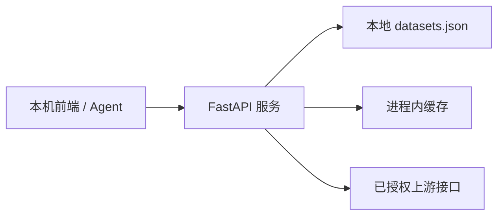

# 首版实施范围（v0.1）

v0.1 的目标是让本机前端或本机 Agent 通过统一 HTTP 接口获取已登记的上游数据。它是单进程、单机、内网优先的最小实现。



## 本版包含

- `config/datasets.json`：本地文件登记上游地址、调用身份、缓存 TTL 和允许的数据集。
- `GET /health`：进程健康检查。
- `GET /v1/datasets`：获取已启用的数据集目录。
- `GET /v1/datasets/{id}`：读取一个已登记数据集；参数经过配置白名单校验。
- 服务端获取并缓存上游 token；调用方永远无法看到 token。
- 进程内响应缓存；可传 `refresh=true` 强制获取一次最新上游响应。
- 首个数据集 `market.limit-up`，对应已整理的涨停池接口。

## 本版不包含

- Redis、数据库、原始数据快照和历史版本。
- 定时抓取、消息队列、交易日历和推送。
- 用户登录、API Key、细粒度权限、管理后台和 MCP 服务。
- 对任意上游 URL、接口号、请求头或方法的透传。

## 扩展接口

在 `config/datasets.json` 的 `datasets` 数组中增加配置项即可，例如：

```json
{
  "id": "market.limit-down",
  "name": "跌停池",
  "pool_id": 5,
  "enabled": true,
  "parameters": {
    "date": {"type": "date", "required": false}
  }
}
```

这会自动出现在 `/v1/datasets`，并允许通过 `/v1/datasets/market.limit-down` 读取。对于需要 `code`、`StockID` 或板块代码的接口，应先在配置和参数校验中显式增加相应规则，不能让用户直接拼接上游参数。

每个新数据集还应定义 `test_cases`。测试用例的 `params` 是真实查询参数，`expect.data_type` 可取 `list`、`object`、`null` 或 `any`，列表型接口可用 `min_items` 规定最低条数。运行 `python -m data_platform.test_runner --mode config` 校验配置；确认上游访问权限后运行 `--mode live` 探测真实接口并输出 JSON 报告。


## 启动与验证

```bash
/opt/miniconda3/bin/python3 -m data_platform.server
curl http://127.0.0.1:8765/health
curl http://127.0.0.1:8765/v1/datasets
curl http://127.0.0.1:8765/v1/datasets/market.limit-up
```

服务仅绑定 `127.0.0.1`。需要让同一局域网的页面访问时，再将 `server.host` 改为具体内网地址，并在下一版加入 API Key 或反向代理认证。

## 后续演进

1. 以 Redis 替换进程内缓存，并加入统一限流。
2. 加入定时调度和持久化快照，形成历史查询能力。
3. 加入 API Key、审计、管理页和更完整的数据集契约。
4. 将同一查询 API 包装为 MCP Server，供 WorkBuddy 等 Agent 调用。
